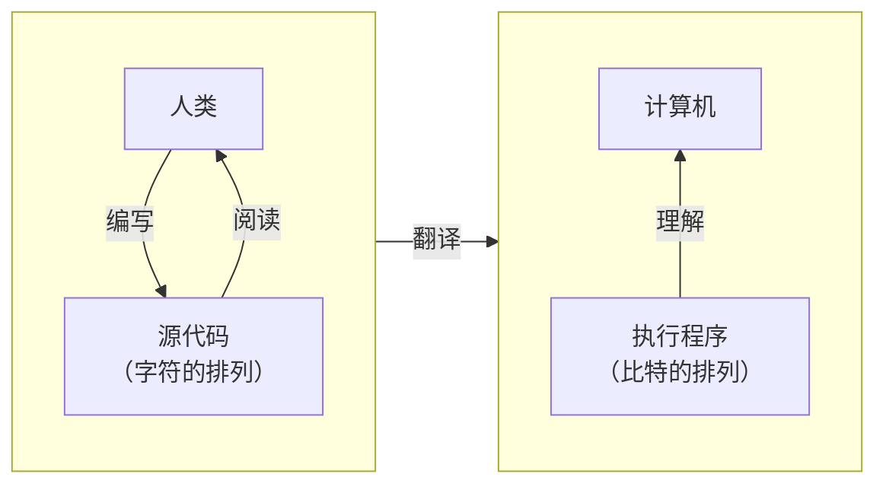
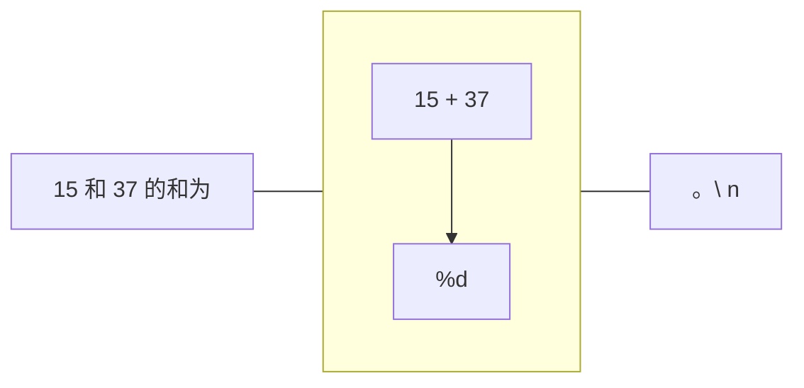

如果说，习惯一件事情就能把它做好，那么同一件事，干得越久就应该更熟练。可现实并不是这样的。举个运动的例子，越是练习，那些本来不太熟练的动作做得越来越烂的情况也不是没有。同样的，编程也不是仅仅习惯就可以的。

重要的是，在开始一件事情时不可或缺的事，是先实际接触一次。在本章节，使用C语言进行轻度的编程吧。

# 1-1 先显示出计算结果

## 求出整数的和并显示

电脑，也叫计算机，正如它的名字一样，它的任务说到底就是**计算**。事不宜迟，让我们使用C语言进行以下的计算吧。

```
计算整数 15 和 37 的和，并显示出来。
```

使用编辑器将 **List 1-1** 的代码抄一遍吧。在C语言程序中，大写和小写、全角和半角是被严格区分的，所以请严格按照下方抄写。

List 1−1
```c
/*
    显示整数 15 和 37 的和
*/
#include <stdio.h>

int main(void) 
{
    printf("%d", 15 + 37);        /* 将整数 15 和 37 用 10 进制显示出来 */

    return (0);
}
```
运行结果
```
52
```

## 程序和编译

像是 **List 1-1** 这样，我们人类使用**字符**的排列编写的程序被称为**源程序（source program）**，保存后的文件被称为**源文件（source file）**。

保存 C 语言的源文件时，我们习惯使用 `.c` 作为文件的扩展名，例如我们刚刚的程序，保存时可以使用 list0101.c 作为文件名。

一般来说，使用字符的排列编写的源程序需要转换成计算机可以理解的**比特**的排列，也就是 0 和 1 的排列。通常需要进行 `Fig.1-1` 所展示的翻译过程（关于比特，请参照**第 7 章**）。

完成这些过程并执行程序后，即可在画面上显示出 `52`。

Fig.1-1 源程序和执行程序


> 编译器或执行环境不同，翻译的顺序或执行的方法也会不同，所以请各位参照自己所使用的编译器的文档等。关于翻译或编译器，在 **Column 1-1** 处有说明。
> 如果在编写源程序的过程中哪里写错了，在翻译时会发生错误，并将错误的详情作为**诊断信息**显示出来。这时，请仔细检查并修复程序中的错误并再次编译。

程序中将多次使用 `#` 或 `{` 之类的符号，可能会有点不习惯。但没关系。慢慢理解就行。

> 关于符号的读法，在之后有总结。

## 注释

源程序中从 `/*` 到 `*/` 的部分被称为**注释（comment）**。是否有注释，以及注释的内容**不会**影响程序的运行。无论使用中文或英文，使用注释通过简短的语言向读者，包括程序的编写者传达内容可以大幅增加代码的可读性。
> 暂且不谈像 **List 1-1** 这么短的程序，阅读并理解其他人写的长程序是非常困难的。并且，永远记得自己写的所有程序是几乎不可能的，所以对于程序的编写者自己，适当留下注释也是很重要的。

```
！重要
编写源程序时，将向读者传递的内容通过注释简短地记录。
```

从刚刚写的程序中也能看出来，注释可以跨越多行。只不过，请不要把用于结束注释的符号错写成 `/*` 了。这会导致到哪都编程注释的。

## 模板

**Fig.1-2** 是将程序的注释去掉后的样子。

Fig.1-2 程序和模板
```diff
-#include <stdio.h>
-
-int main(void)
-{
+    printf("%d", 15 + 37);
-
-    return (0);
-}
```

请记住红色（-）部分是固定的“模板”。关于它们的意思会在后面的章节里慢慢讲解的。现在只需要将它们完整背下来即可。

现阶段，“模板”部分的代码可以无脑复制，其它地方要认真编写。

## printf - 进行格式化显示的函数

用于显示内容的是一个名叫`printf`的**函数（function）**（`printf` 一般读作 \[prɪnt.ɛf\]，末尾的 f 来自“格式”的英文单词 format）。

函数需要通过**函数调用（function call）**的方式使用。**Fig.1-3**展示了调用 `printf` 函数显示出 15 和 37 的和的部分。

Fig.1-3 `printf` 函数的调用
```c
printf("%d", 15 + 37);
```
| 函数名 | 实参 | 实参 |
| ----- | --- | --- |
| printf | "%d" | 15 + 37 |

这个函数调用表示了“显示”的一种请求，具体的指定由 `()` 内给定的**实参（argument）**决定。并且像是这个例子中的，有两个及以上实参的情况，请使用逗号 `,` 区隔。

`printf` 函数的第一个实参 `"%d"` 用于指定输出的格式，也就是**将接下来的实参用 10 进制显示出来**的意思。也就是说，这个调用会将第二个实参 15+37 的值，也就是 15 和 37 的和，显示为 `52`。

> `"%d"` 的 d 来自“10进制”的英文单词 decimal。关于 10 进制或 2 进制在第 7 章的 7-1，使用 8 进制或 16 进制的表示方式在第 7 章的 7-2 里有说明。
> 有关 `printf` 函数的详情在附录 2 中有总结。

```
！重要
函数调用是用于执行操作的请求，调用时，具体的指定作为实参传入。
```

## 语句

仔细看看我们写的程序。`printf` 函数调用的末尾以及模板代码的
```c
return (0);
```
的末尾都有一个分号 `;`。这和中文里的句号 `。` 的作用相同。

就像在中文里，一段正确的句子的末尾需要加上句号一样，C 语言中，一段正确的**语句（statement）**末尾需要加上分号。
```
！重要
语句的末尾，原则上都需要加上分号;
```

## 计算整数的差

**List 1-2** 展示了将从 15 减去 37 的值显示出来的程序。

List 1-2
```c
/*
    显示出整数 15 减去 37 的值。
*/
#include <stdio.h>

int main(void)
{
    printf("%d", 15 - 37);

    return (0);
}
```
运行结果
```
-22
```

运行程序后，会显示出 `-22`。可以看到，当计算结果为负数时，数字前会被加上负号。

### Column 1-1 翻译阶段和编译
要执行 C 语言程序，理论上会经历 8 个阶段的**翻译阶段（translation phase）**。执行源程序所需要的软件被称为**编译器（implementation）**。
C 语言的编译器的绝大多数，都是将源程序“翻译”成计算机可以直接理解、执行的形式，也就是**编译方式**（在本文里介绍的方式），但也有一些是一行一行解释并执行的**解释执行方式**（执行速度稍慢）等。

## 格式化字符串和转换说明

执行程序后，仅仅显示出和或差，不免有些令人费解，所以我们让输出的信息变得更亲切。例如 **List 1-3** 的程序。

这次 `printf` 函数的第一个实参会变长、变复杂。

List 1-3
```c
/*
    亲切地显示整数 15 和 37 的和
*/
#include <stdio.h>

int main(void)
{
    printf("15 和 37 的和为 %d。\n", 15 + 37);        /* 显示后换行 */

    return (0);
}
```
执行结果
```
15 和 37 的和为 52。
```

此前没讲到的，`printf` 函数的第一个实参，也就是被双引号 `"` 引起来的部分被称为**格式化字符串（format string）**。

格式化字符串的 `%d` 是用于**将接下来的实参用 10 进制显示出来**的**转换说明（conversion specification）**。格式化字符串中**不是**转换说明的部分（通常）会直接输出。

格式化字符串末尾的 `\n` 是用于表示**换行（new line）**的特殊标记。`\` 和 `n` 组合起来可以表示名为“换行字符”的特殊字符。

> 日本的很多电脑所采用的名为 JIS 码的文字体系（第 8 章 8-4）中，反斜杠 `\` 会显示为元符号 `¥`，所以在大家的环境里可能会需要使用 `¥`。如果是这样，请将这篇文章中的所有 `\` 当作 `¥`（如果是在网页阅读，或你看到的就是 `¥`，请反着理解这段话）。顺带一提，在最后会需要换行的理由请参照 **Column 1-2**。

**Fig.1-4** 展示了刚刚的程序输出时的样子。




