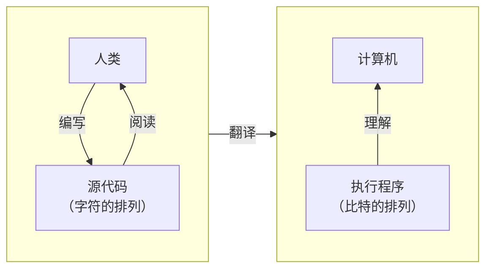

如果说，习惯一件事情就能把它做好，那么同一件事，干得越久就应该更熟练。可现实并不是这样的。举个运动的例子，越是练习，那些本来不太熟练的动作做得越来越烂的情况也不是没有。同样的，编程也不是仅仅习惯就可以的。

重要的是，在开始一件事情时不可或缺的事，是先实际接触一次。在本章节，使用C语言进行轻度的编程吧。

# 1-1 先显示出计算结果

## 求出整数的和并显示

电脑，也叫计算机，正如它的名字一样，它的任务说到底就是**计算**。事不宜迟，让我们使用C语言进行以下的计算吧。

> 计算整数 15 和 37 的和，并显示出来。

使用编辑器将 **List 1-1** 的代码抄一遍吧。在C语言程序中，大写和小写、全角和半角是被严格区分的，所以请严格按照下方抄写。

List 1−1
```c
/*
    显示整数 15 和 37 的和
*/
#include <stdio.h>

int main(void) 
{
    printf("%d", 15 + 37);        /* 将整数 15 和 37 用 10 进制显示出来 */
    return (0);
}
```

## 程序和编译

像是 **List 1-1** 这样，我们人类使用**字符**的排列编写的程序被称为**源程序（source program）**，保存后的文件被称为**源文件（source file）**。

保存 C 语言的源文件时，我们习惯使用 `.c` 作为文件的扩展名，例如我们刚刚的程序，保存时可以使用 list0101.c 作为文件名。

一般来说，使用字符的排列编写的源程序需要转换成计算机可以理解的**比特**的排列，也就是 0 和 1 的排列。通常需要进行 `Fig.1-1` 所展示的翻译过程（关于比特，请参照**第 7 章**）。

完成这些过程并执行程序后，即可在画面上显示出 `52`。

Fig.1-1 源程序和执行程序


> 编译器或执行环境不同，翻译的顺序或执行的方法也会不同，所以请各位参照自己所使用的编译器的文档等。关于翻译或编译器，在 **Column 1-1** 处有说明。
> 如果在编写源程序的过程中哪里写错了，在翻译时会发生错误，并将错误的详情作为**诊断信息**显示出来。这时，请仔细检查并修复程序中的错误并再次编译。

程序中将多次使用 `#` 或 `{` 之类的符号，可能会有点不习惯。但没关系。慢慢理解就行。

> 关于符号的读法，在之后有总结。

## 注释

源程序中从 `/*` 到 `*/` 的部分被称为**注释（$comment$）**。

