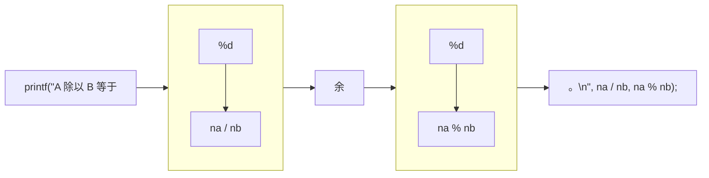

如果有人问你你的身高和体重，你会怎么回答呢？比如你可能会回答”我 175cm 高，60kg 重“之类的吧。但是，这大概是假的（？）吧。首先，身高不可能刚刚好等于 175cm。即使用身高计测出了 175.3cm 的结果，也不能说这就是正确的。真正的值应该是类似 175.2869758...cm 之类的值（并且还会随时间不断变化）。但是，一般情况下我们说”我 175cm 高，60kg 重“已经足够了。因为没有人需要知道真正正确的值。... 程序的世界也一样。没有必要将现实里的值全都正确表示。

本章节将学习 C 语言中使用数值所需的最基本的内容，也就是关于运算和类型的基本知识。

# 2-1 运算

## 四则运算

我们在**第 1 章**中进行了加法、减法、乘法的运算。这次来试试除法。

```
输入两个整数，显示它们的和、差、积、商和余数。
```

**List 2-1** 展示了实现的代码。

List 2-1
```c
/*
    显示输入的两个整数的和、差、积、商和余数。
*/

#include <stdio.h>

int main(void)
{
    int vx, vy;

    puts("请输入两个整数。");
    printf("整数 vx："); scanf("%d", &vx);
    printf("整数 vy："); scanf("%d", &vy);

    printf("vx + vy = %d\n", vx + vy);
    printf("vx - vy = %d\n", vx - vy);
    printf("vx * vy = %d\n", vx * vy);
    printf("vx / vy = %d\n", vx / vy);
    printf("vx %% vy = %d\n", vx % vy);

    return (0);
}
```
运行例
```
请输入两个整数。
整数 vx：57↵
整数 vy：21↵
vx + vy = 78
vx - vy = 36
vx * vy = 1197
vx / vy = 2
vx % vy = 15
```

> `vx - vy` 求的只是从 `vx` 减去 `vy` 的值，不一定是差。也就是说，如果 `vy` 比 `vx` 要大，`vx - vy` 的值会变成负数。求差的程序在**第 3 章 3-1** 里有展示。

## 运算符和操作数

**第 1 章**里已经说过，`*` 是求积的符号。像这样用于运算的符号被称为**运算符（operator）**，参与运算的变量或常量被称为**操作数（operand）**。比如，进行加法运算的
```c
vx + vy
```
当中，运算符是 `+`，操作数是 `vx` 和 `vy`。

左侧的操作数被称为**第 1 操作数**或**左操作数**，右侧的操作数被称为**第 2 操作数**或**右操作数**。

> C 语言中有很多运算符。在第 7 章 7-4 里可以看到一张所有运算符的表格。

## 商和余数

求**商**的运算符是 `/`。
```
整数 / 整数    （商的整数部分）
```
这样的运算会得到商的整数部分，也就是将小数点以下舍去的值。比如 `5 / 3` 会得到 1，`3 / 5` 会得到 0。而
```
整数 % 整数    （余数）
```
会得到**余数**。比如 `5 % 3` 会得到 2，`3 % 5` 会得到 3。

> 请参照 **Column 2-1**

## 乘除运算符和加减运算符

这个程序中用到的五个运算符可以大致分为 **Table 2-1** 的**乘除运算符（multiplicative operator）** 和 **Table 2-2** 的**加减运算符（additive operator）**。

请记住这些运算符的名字。

Table 2-1 乘除运算符
| 名称 | 写法 | 解释 |
| --- | --- | --- |
| 二元 `*` 运算符 | `a * b` | `a` 和 `b` 的积。 |
| `/` 运算符 | `a / b` | `a` 除以 `b` 的商（都是整数的情况下会将小数点以下舍去） |
| `%` 运算符 | `a % b` | `a` 除以 `b` 的余数（`a` 和 `b` 都得是整数） |

Table 2-2 加减运算符
| 名称 | 写法 | 解释 |
| 二元 `+` 运算符 | `a + b` | `a` 和 `b` 的和。 |
| 二元 `-` 运算符 | `a - b` | 从 `a` 减去 `b` 的值 |

> 这些运算符的英文名称，乘除运算符分别叫 binary `*` operator、`/` operator 和 `%` operator，加减运算符分别叫 binary `+` operator 和 binary `-` operator。

## 用 printf 显示 % 字符

注意到显示余数的那行代码，格式化字符串里的 `%` 多了一个。这是因为像是 `%d` 这样，在格式化字符串内的 `%` 担任了指定格式，也就是转换说明的作用。

所以，如果不是要指定格式，而是真的想要显示出 `%` 的话，需要 `%%` 这样写。

> 如果是使用没有格式化功能的 `puts` 函数，则不能使用 `%%`（会直接显示出 `%%`）。

## 求最低位

使用求余数的运算符，就可以解决下面的问题。

```
将输入整数的最低位（个位）的数字显示出来
```

**List 2-2** 展示了实现的代码。

List 2-2
```c
/*
    显示输入整数的最低位
*/

#include <stdio.h>

int main(void)
{
    int no;

    printf("请输入整数：");
    scanf("%d", &no);

    printf("最低位的数字是 %d。\n", no % 10);

    return (0);
}
```
运行例（1）
```
请输入整数：1357↵
最低位的数字是 7。
```
运行例（2）
```
请输入整数：1780↵
最低位的数字是 0。
```

将整数除以 10 后的余数就是最低位的数字了。

```
练习 2-1
写一个程序，和下面一样，输入两个整数，输出第一个整数是第二个整数的百分之几。
请输入两个整数。
整数 A：54↵
整数 B：84↵
A 的值是 B 的 64%。
```

### Column 2-1 % 运算符和操作数

求余数的 `%` 运算符所生成的值依赖一套较为复杂的规则。
- 如果两个操作数都为正数，则计算结果为正。
```
正 % 正 → 正
```
- 注意，两个操作数的至少一个为负数，运算的结果需要结合编译器判断。也就是说，编译器不同，得到的值也可能不同（所以在实际开发时要避免进行这种运算）。
```
负 % 负 → 结果根据编译器的不同会有差异
正 % 负 → 结果根据编译器的不同会有差异
负 % 正 → 结果根据编译器的不同会有差异
```

## 指定多个转换说明

**List 2-3** 展示了输入两个整数后输出它们的商和余数的程序。

List 2-3
```c
/*
    显示输入的两个整数的商和余数
*/

#include <stdio.h>

int main(void)
{
    int na, nb;

    puts("请输入两个整数。");
    printf("整数 A："); scanf("%d", &na);
    printf("整数 B："); scanf("%d", &nb);

    printf("A 除以 B 等于 %d 余 %d。\n", na / nb, na % nb);

    return (0);
}
```
运行例
```
请输入两个整数。
整数 A：57↵
整数 B：21↵
A 除以 B 等于 2 余 15。
```

程序中输出结果的格式字符串里包含两个转换说明 `%d`。就像 **Fig.2-1** 所展示的这样，每个转换说明分别对应左边的第二个实参和第三个实参。

当然，只要实参对得上，转换说明有几个都行。

Fig.2-1 使用 `printf` 函数格式化两个值并显示


想要一次性格式化两个以上的数值并显示的时候，就可以像这样在格式化字符串里指定多个转换说明。

```
练习 2-2
写一个程序，像下面一样，输入两个整数，输出它们的和和积。

请输入两个整数。
整数 A：54↵
整数 B：12↵
它们的和为 66，积为 648。
```

## 一元算数运算符

这次来思考一下下面的问题

```
显示输入整数的相反数（符号相反的数）
```

也就是说，输入 `75` 后要输出 `-75`，输入 `-64` 后要输出 `64`。**List 2-4** 展示了实现的程序。

List 2-4
```c
/*
    显示输入整数的相反数
*/

#include <stdio.h>

int main(void)
{
    int num;

    printf("请输入整数：");
    scanf("%d", &num);

    printf("输入数的相反数为 %d。\n"， -num);    /* 一元-运算符 */

    return (0);
}
```
运行例（1）
```
请输入整数：75↵
输入数的相反数为 -75。
```
运行例（2）
```
请输入整数：-64↵
输入数的相反数为 64。
```

目前为止，我们所使用的运算符都需要两个操作数。像这样的运算符被称作**二元**运算符。除此之外，C 语言的运算符还有只需要一个操作数的**一元**运算符和需要三个操作数的**三元运算符**。

在这次的程序里第一次出现的运算符叫作**一元 - 运算符（unary - operator）**。正如程序的运行结果那样，这个 `-` 运算符会生成和操作符符号相反的数。与之相对的还有**一元 + 运算符（unary + operator）**。**Table 2-3** 总结了这两个运算符。

Table 2-3 一元 `+` 运算符和一元 `-` 运算符
| 名称 | 写法 | 解释 |
| --- | --- | --- |
| 


