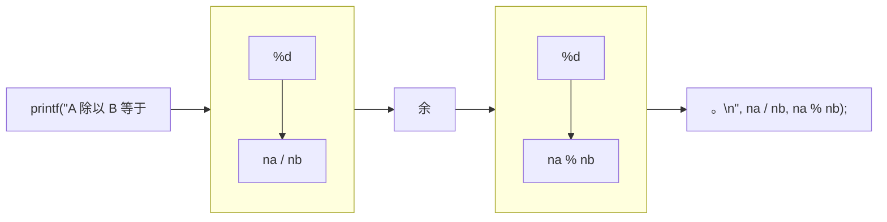
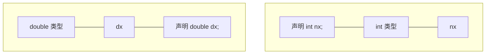
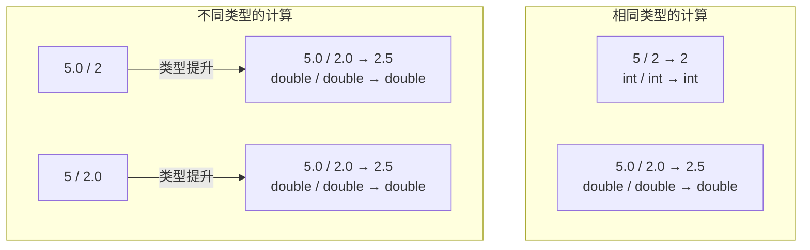

如果有人问你你的身高和体重，你会怎么回答呢？比如你可能会回答”我 175cm 高，60kg 重“之类的吧。但是，这大概是假的（？）吧。首先，身高不可能刚刚好等于 175cm。即使用身高计测出了 175.3cm 的结果，也不能说这就是正确的。真正的值应该是类似 175.2869758...cm 之类的值（并且还会随时间不断变化）。但是，一般情况下我们说”我 175cm 高，60kg 重“已经足够了。因为没有人需要知道真正正确的值。... 程序的世界也一样。没有必要将现实里的值全都正确表示。

本章节将学习 C 语言中使用数值所需的最基本的内容，也就是关于运算和类型的基本知识。

# 2-1 运算

## 四则运算

我们在**第 1 章**中进行了加法、减法、乘法的运算。这次来试试除法。

```
输入两个整数，显示它们的和、差、积、商和余数。
```

**List 2-1** 展示了实现的代码。

List 2-1
```c
/*
    显示输入的两个整数的和、差、积、商和余数。
*/

#include <stdio.h>

int main(void)
{
    int vx, vy;

    puts("请输入两个整数。");
    printf("整数 vx："); scanf("%d", &vx);
    printf("整数 vy："); scanf("%d", &vy);

    printf("vx + vy = %d\n", vx + vy);
    printf("vx - vy = %d\n", vx - vy);
    printf("vx * vy = %d\n", vx * vy);
    printf("vx / vy = %d\n", vx / vy);
    printf("vx %% vy = %d\n", vx % vy);

    return (0);
}
```
运行例
```
请输入两个整数。
整数 vx：57↵
整数 vy：21↵
vx + vy = 78
vx - vy = 36
vx * vy = 1197
vx / vy = 2
vx % vy = 15
```

> `vx - vy` 求的只是从 `vx` 减去 `vy` 的值，不一定是差。也就是说，如果 `vy` 比 `vx` 要大，`vx - vy` 的值会变成负数。求差的程序在**第 3 章 3-1** 里有展示。

## 运算符和操作数

**第 1 章**里已经说过，`*` 是求积的符号。像这样用于运算的符号被称为**运算符（operator）**，参与运算的变量或常量被称为**操作数（operand）**。比如，进行加法运算的
```c
vx + vy
```
当中，运算符是 `+`，操作数是 `vx` 和 `vy`。

左侧的操作数被称为**第 1 操作数**或**左操作数**，右侧的操作数被称为**第 2 操作数**或**右操作数**。

> C 语言中有很多运算符。在第 7 章 7-4 里可以看到一张所有运算符的表格。

## 商和余数

求**商**的运算符是 `/`。
```
整数 / 整数    （商的整数部分）
```
这样的运算会得到商的整数部分，也就是将小数点以下舍去的值。比如 `5 / 3` 会得到 1，`3 / 5` 会得到 0。而
```
整数 % 整数    （余数）
```
会得到**余数**。比如 `5 % 3` 会得到 2，`3 % 5` 会得到 3。

> 请参照 **Column 2-1**

## 乘除运算符和加减运算符

这个程序中用到的五个运算符可以大致分为 **Table 2-1** 的**乘除运算符（multiplicative operator）** 和 **Table 2-2** 的**加减运算符（additive operator）**。

请记住这些运算符的名字。

Table 2-1 乘除运算符
| 名称 | 写法 | 解释 |
| --- | --- | --- |
| 二元 `*` 运算符 | `a * b` | `a` 和 `b` 的积。 |
| `/` 运算符 | `a / b` | `a` 除以 `b` 的商（都是整数的情况下会将小数点以下舍去） |
| `%` 运算符 | `a % b` | `a` 除以 `b` 的余数（`a` 和 `b` 都得是整数） |

Table 2-2 加减运算符
| 名称 | 写法 | 解释 |
| --- | --- | ---- |
| 二元 `+` 运算符 | `a + b` | `a` 和 `b` 的和。 |
| 二元 `-` 运算符 | `a - b` | 从 `a` 减去 `b` 的值 |

> 这些运算符的英文名称，乘除运算符分别叫 binary `*` operator、`/` operator 和 `%` operator，加减运算符分别叫 binary `+` operator 和 binary `-` operator。

## 用 printf 显示 % 字符

注意到显示余数的那行代码，格式化字符串里的 `%` 多了一个。这是因为像是 `%d` 这样，在格式化字符串内的 `%` 担任了指定格式，也就是转换说明的作用。

所以，如果不是要指定格式，而是真的想要显示出 `%` 的话，需要 `%%` 这样写。

> 如果是使用没有格式化功能的 `puts` 函数，则不能使用 `%%`（会直接显示出 `%%`）。

## 求最低位

使用求余数的运算符，就可以解决下面的问题。

```
将输入整数的最低位（个位）的数字显示出来
```

**List 2-2** 展示了实现的代码。

List 2-2
```c
/*
    显示输入整数的最低位
*/

#include <stdio.h>

int main(void)
{
    int no;

    printf("请输入整数：");
    scanf("%d", &no);

    printf("最低位的数字是 %d。\n", no % 10);

    return (0);
}
```
运行例（1）
```
请输入整数：1357↵
最低位的数字是 7。
```
运行例（2）
```
请输入整数：1780↵
最低位的数字是 0。
```

将整数除以 10 后的余数就是最低位的数字了。

```
练习 2-1
写一个程序，和下面一样，输入两个整数，输出第一个整数是第二个整数的百分之几。
请输入两个整数。
整数 A：54↵
整数 B：84↵
A 的值是 B 的 64%。
```

### Column 2-1 % 运算符和操作数

求余数的 `%` 运算符所生成的值依赖一套较为复杂的规则。
- 如果两个操作数都为正数，则计算结果为正。
```
正 % 正 → 正
```
- 注意，两个操作数的至少一个为负数，运算的结果需要结合编译器判断。也就是说，编译器不同，得到的值也可能不同（所以在实际开发时要避免进行这种运算）。
```
负 % 负 → 结果根据编译器的不同会有差异
正 % 负 → 结果根据编译器的不同会有差异
负 % 正 → 结果根据编译器的不同会有差异
```

## 指定多个转换说明

**List 2-3** 展示了输入两个整数后输出它们的商和余数的程序。

List 2-3
```c
/*
    显示输入的两个整数的商和余数
*/

#include <stdio.h>

int main(void)
{
    int na, nb;

    puts("请输入两个整数。");
    printf("整数 A："); scanf("%d", &na);
    printf("整数 B："); scanf("%d", &nb);

    printf("A 除以 B 等于 %d 余 %d。\n", na / nb, na % nb);

    return (0);
}
```
运行例
```
请输入两个整数。
整数 A：57↵
整数 B：21↵
A 除以 B 等于 2 余 15。
```

程序中输出结果的格式字符串里包含两个转换说明 `%d`。就像 **Fig.2-1** 所展示的这样，每个转换说明分别对应左边的第二个实参和第三个实参。

当然，只要实参对得上，转换说明有几个都行。

Fig.2-1 使用 `printf` 函数格式化两个值并显示


想要一次性格式化两个以上的数值并显示的时候，就可以像这样在格式化字符串里指定多个转换说明。

```
练习 2-2
写一个程序，像下面一样，输入两个整数，输出它们的和和积。

请输入两个整数。
整数 A：54↵
整数 B：12↵
它们的和为 66，积为 648。
```

## 一元算数运算符

这次来思考一下下面的问题

```
显示输入整数的相反数（符号相反的数）
```

也就是说，输入 `75` 后要输出 `-75`，输入 `-64` 后要输出 `64`。**List 2-4** 展示了实现的程序。

List 2-4
```c
/*
    显示输入整数的相反数
*/

#include <stdio.h>

int main(void)
{
    int num;

    printf("请输入整数：");
    scanf("%d", &num);

    printf("输入数的相反数为 %d。\n"， -num);    /* 一元-运算符 */

    return (0);
}
```
运行例（1）
```
请输入整数：75↵
输入数的相反数为 -75。
```
运行例（2）
```
请输入整数：-64↵
输入数的相反数为 64。
```

目前为止，我们所使用的运算符都需要两个操作数。像这样的运算符被称作**二元**运算符。除此之外，C 语言的运算符还有只需要一个操作数的**一元**运算符和需要三个操作数的**三元运算符**。

在这次的程序里第一次出现的运算符叫作**一元 - 运算符（unary - operator）**。正如程序的运行结果那样，这个 `-` 运算符会生成和操作符符号相反的数。与之相对的还有**一元 + 运算符（unary + operator）**。**Table 2-3** 总结了这两个运算符。

Table 2-3 一元 `+` 运算符和一元 `-` 运算符
| 名称 | 写法 | 解释 |
| --- | --- | --- |
| 一元 `+` 运算符 | `+a` | `a` 的值 |
| 一元 `-` 运算符 | `-a` | 和 `a` 的符号相反的值（相反数） |

> 也就是说 `+` 和 `-` 都有一元的版本和二元的版本。一元 `+` 运算符实际上不会进行任何的运算，只是为了和一元 `-` 运算符成对出现而存在。
> 顺带一提，一元 `+` 运算符、一元 `-` 运算符、`!` 运算符（第 4 章 4-1）和 `~` 运算符（第 7 章 7-2）这四个被称为**一元算数运算符（unary arithmetic operator）**。

## 赋值运算符

**Table 2-4** 的运算符到现在还没好好介绍，但在程序里出现了很多次。这个写作 `=` 的运算符被称为**赋值运算符（assignment operator）**。

> 和在第 4 章出现的**复合赋值运算符**相对的，普通的 `=` 严格来说应该叫 **简单赋值运算符（simple assignment operator）**。

Table 2-4
| 名称 | 写法 | 解释 |
| --- | --- | --- |
| 简单赋值运算符 | `a = b` | 将 `b` 的值赋值给 `a` |

## 表达式和赋值表达式

常量或变量，以及它们和运算符结合起来组成的东西被称为**表达式（expression）**。比如，
```c
vx + 32
```
这个例子，`vx`，`32`，`vx + 32` 都是表达式。而像是
```c
vc = vx + 32
```
这个例子，`vc`、`vx`、`32`、`vx + 32`、`vc = vx + 32` 也都是表达式。当然，`vc` 是赋值表达式的第 1 操作数，`vx + 32` 是第 2 操作数。

请记住，使用赋值运算符写的这样的表达式被称为**代入表达式（assignment expression）**。

## 表达式语句

正如在第 1 章的 1-1 中介绍的，原则上，语句的结尾需要一个分号 `;`，所以刚刚的代入表达式要写成下面这样才算是一条正确的**语句**。
```c
vc = vx + 32;    /* 表达式语句 */
```

像这样，在表达式后面加一个分号的语句被称为**表达式语句（expression statement）**。

> 关于表达式语句，在第 6 章 6-2 里有更详细的解释。在接下来的章节，除了表达式语句外，还会学习 `if` 语句和 `while` 语句等。

# 2-2 类型

## 求平均值


思考下面的问题。

```
输入两个整数，求出它们的平均值。
```

**List 2-5** 展示了实现的程序。

List 2-5
```c
/*
    显示输入的两个数字的平均值
*/

# include <stdio.h>

int main(void)
{
    int na, nb;

    puts("请输入两个整数。");
    printf("整数 A："); scanf("%d", &na);
    printf("整数 B："); scanf("%d", &nb);

    printf("它们的平均值为 %d。\n", (na + nb) / 2);

    return (0);
}
```
运行例
```
请输入两个整数。
整数 A：40↵
整数 B：45↵
它们的平均值为 42。
```

包裹表达式 `na + nb` 的 `()` 表示让这个表达式优先计算。如果这个表达式写成
```c
na + nb / 2
```
的话，计算的结果就会变成 `na` 和 `nb / 2` 的和。这和我们平常计算时的规则，先乘除后加减相同。

> 所有运算符的**计算顺序**在第 7 章 7-4 里有总结。

## 类型

从运行例也能看出来，平均值没有显示为 `42.5` 而是 `42`。换句话说，小数点之后的部分被**舍去**了。

**int** 这种**类型（type）** 的特性就是只能存储整数。

## int 类型和 double 类型

C语言中，实数使用**浮点数（floating-point number）** 的形式表示。虽然浮点数的类型不止一种，但在这里，我们将学习 **double** 类型。**List 2-6** 展示了整数的 **int** 类型和浮点数的 **double** 类型的区别。

List 2-6
```c
/*
    整数和浮点数
*/

#include <stdio.h>

int main(void)
{
    int    nx;
    double dx;

    nx = 9.99;    /* 整数 */
    dx = 9.99;    /* 浮点数 */

    printf("   int 类型变量 nx 的值为：%d\n", nx);        /*   9        */
    printf("               nx / 2：  %d\n", nx / 2);    /*   9 / 2    */

    printf("double 类型变量 dx 的值为：%f\n", dx);        /* 9.99       */
    printf("               dx / 2.0：%f\n", dx / 2.0);  /* 9.99 / 2.0 */

    return (0);
}
```
运行结果
```
   int 类型变量 nx 的值为：9
               nx / 2：  4
double 类型变量 dx 的值为：9.990000
               dx / 2.0：4.995000
```

将变量 `nx` 声明为 **int** 类型，变量 `dx` 声明为 **double** 类型，并代入 `9.99`。正如 **Fig.2-2** 所展示的那样，往 **int** 类型变量里代入实数后，小数点之后的部分被**舍去**了。所以 `nx` 的值为 `9`。

当然，在计算 `nx / 2` 也就是 `9 / 2` 时，因为是**整数 / 整数** 的计算，结果也会舍去小数点之后的部分（第 2 章 2-1）。

注意 `printf` 函数中显示 `double` 类型的转换说明使用的是 `%f` 而不是 `%d`。

> 转换说明 `%f` 的 `f` 来自浮点数的英文单词 `floating-point` 的首字母。默认会显示小数点后 6 位，更改显示位数的方法在本节后半部分里有讲解。

Fig.2-2 整数和浮点数
| `int` 类型 | `double` 类型 |
| --------- | ------------- |
| `nx` | `dx` |
| 9.~~99~~（小数点以下被舍去） | 9.99 |

## 类型和对象

让我们进一步学习关于类型和变量吧。

从 **Fig.2-3** 中可以看出来，表示类型的方框和表示变量的方框的大小是一样的。

**Fig.2-3** 类型和对象


从刚刚的程序也能知道，**int** 类型只能表示整数。就算代入实数，也只会接收它的整数部分。

而作为浮点数的 **double** 类型还可以表示包括小数点以下部分的实数。

在第 7 章会详细讲解，C 语言自带了很多类型。

但是每个类型并不能表示无限的精度。比如，**int** 类型所能保证的范围只从 -32767 到 32767 为止。

> 根据编译器的不同，有的也能表示更大的数字范围。请参照第 7 章 7-2。

每个类型都有其特有的性质，将这种性质继承下来的实体，准确来说被称为**对象（object）**。可以像下面这样理解。

```
！重要

类型是指，记录某些特性的设计图（章鱼烧的模具），拥有类型的对象（变量）是按照这个类型做出来的实体（从模具做出来的章鱼烧本体）。
```

只不过，变量这个词语用得更多，也给人一种更加亲近的感觉，所以在本教程中，如果没有严格的区分要求，通常会使用”变量“这个词而非”对象“。

## 整数常量和浮点数常量

直接写在程序里的常量也拥有类型。像是 `5` 或者 `37` 之类的常量，因为它们是整数类型，所以被称为**整数常量（integer constant）**，而像 `3.14` 这样有小数部分的数字被称为**浮点数常量（floating constant）**。

一般来说，整数常量是 **int** 类型，浮点数常量是 **double** 类型的。

> 类型会根据数值的大小或额外的指定变化。请参照**第 7 章**。

## double 类型的计算

**List 2-7** 展示了输入两个实数，输出它们的和差积商的程序。

List 2-7
```c
/*
    显示输入的两个数字的和差积商
*/

#include <stdio.h>

int main(void)
{
    double vx, vy;    /* 浮点数 */

    puts("请输入两个数。");
    printf("实数 vx："); scanf("%lf", &vx);
    printf("实数 vy："); scanf("%lf", &vy);

    printf("vx + vy = %f\n", vx + vy);
    printf("vx - vy = %f\n", vx - vy);
    printf("vx * vy = %f\n", vx * vy);
    printf("vx / vy = %f\n", vx / vy);

    return (0);
}
```
运行例
```
请输入两个数。
实数 vx：40.5↵
实数 vy：5.2↵
vx + vy = 45.700000
vx - vy = 35.300000
vx * vy = 210.600000
vx / vy = 7.788462
```

正如 **Table 2-5** 所总结的，读取 **double** 类型的变量时传入 `scanf` 函数的转换说明为 `"%lf"`，需要注意。

Table 2-5 转换说明
|          | **int** 类型 | **double** 类型 |
| -------- | ----------- | --------------- |
| `printf` | `printf("%d", no)` | `printf("%f", no)` |
| `scanf`  | `scanf("%d", &no)` | `scanf("%lf", &no)` |

```
练习 2-3

像下面这样，将输入的实数直接输出。

请输入实数：57.3↵
你输入了 57.300000。
```

## 类型和运算

`整数 / 整数` 的计算结果会舍掉商的小数点之后的部分。但如果是**浮点数之间的计算则不会舍去**。

> 只不过，`%` 运算符因为其特性，只能进行整数间的计算，**无法用作**浮点数的运算。

正如 **Fig.2-4** 所展示的，像是 `int / int` 或者 `double / double` 这样的，两边的操作数的类型一致的情况下，计算结果的类型会和参与计算的操作数的类型一致。

但如果是像 `int / double` 或者 `double / int` 这样，一边的操作数是 **int** 类型，另一边是 **double** 类型的话，**int** 类型的操作数会**提升**成 **double** 类型，也就是进行了**隐式类型转换**。所以计算的结果也会变成 **double** 类型。

当然，这个规则也适用于 `+` 以及 `*` 之类的其它运算。

Fig.2-4 运算和类型


C 语言中有很多类型，具体的规则比较复杂，但大致上可以像下面这样理解（具体规则在第 7 章 7-4 里有写）。

```
！重要
参与运算的操作数的类型不同时，小的操作数会被转换成大的（适用范围更广的）操作数进行运算。
```

> 在这里用了“大的”进行了说明，但并不是说 **double** 类型在内存里一定比 **int** 要大。只是说它可以存下小数点后的内容。

用 **List 2-8** 的程序来验证一下这些内容吧。

List 2-8
```c
/*
    验证类型和运算相关的内容
*/

#include <stdio.h>

int main(void)
{
    int    n1, n2, n3, n4;    /* 整数 */
    double d1, d2, d3, d4;    /* 浮点数 */

    n1 = 5   / 2;        /* n1 ← 2 */
    n2 = 5.0 / 2.0;      /* n2 ← 2.5（赋值时会舍去小数点以后） */
    n3 = 5.0 / 2;        /* n3 ← 2.5（赋值时会舍去小数点以后） */
    n4 = 5   / 2.0;      /* n4 ← 2.5（赋值时会舍去小数点以后） */

    d1 = 5   / 2;        /* d1 ← 2 */
    d2 = 5.0 / 2.0;      /* d2 ← 2.5 */
    d3 = 5.0 / 2;        /* d3 ← 2.5 */
    d4 = 5   / 2.0;      /* d4 ← 2.5 */

    printf("n1 = %d\n", n1);
    printf("n2 = %d\n", n2);
    printf("n3 = %d\n", n3);
    printf("n4 = %d\n\n", n4);

    printf("d1 = %f\n", d1);
    printf("d2 = %f\n", d2);
    printf("d3 = %f\n", d3);
    printf("d4 = %f\n", d4);

    return (0);
}
```
运行结果
```
n1 = 2
n2 = 2
n3 = 2
n4 = 2

d1 = 2.000000
d2 = 2.500000
d3 = 2.500000
d4 = 2.500000
```

**int** 类型的变量 `n1` 被赋值了 `2`，`n2`、`n3`、`n4` 被赋值了 `2.5`。但由于在赋值时会舍去小数点后的部分，所以这四个变量最终都会变成 `2`。

而将 **double** 类型的变量 `d1` 赋值为 `2`，`d2`、`d3`、`d4` 赋值为 `2.5` 后，可以完整保存它们的值。

> 浮点数由于无法保存无限的精度，所以有时候无法表示所有正确的位数。请参照第 7 章 7-3。

```
练习 2-4
使用整数常量、浮点数常量、int 类型变量、double 类型变量进行乘除运算，验证类型转换的规则。
```

## 类型转换

用来计算两个整数的平均值的程序 **List 2-5** 算出来的平均值只能显示出整数部分。这次，我们让它的小数点之后的部分也显示出来。**List 2-9** 展示了实现的程序。

List 2-9
```c
/*
    用实数显示输入的两个整数的平均值
*/

#include <stdio.h>

int main(void)
{
    int na, nb;

    puts("请输入两个整数。");
    printf("整数 A："); scanf("%d", &na);
    printf("整数 B："); scanf("%d", &nb);

    printf("它们的平均值为 %f。\n", (na + nb) / 2.0);

    return (0);
}
```
运行例
```
请输入两个整数。
整数 A：40↵
整数 B：45↵
它们的平均值为 42.500000。
```

注意看求平均值的式子。
```c
(na + nb) / 2.0
```
首先会先计算 `()` 里的表达式。这个计算是 `int + int`，也就是 `整数 + 整数`，所以计算结果也会是整数的 **int** 类型。

也就是会变成
```c
(整数) / 2.0
```
因为这次变成了
```c
整数 / 实数
```
所以它的结果也会是实数。

像这样，就可以求出实数值的平均值了。

但是，在我们平常的生活中要求平均值时，我们脑子里通常想的是“除以 2”，而**不会**想“除以 2.0”。

**List 2-10** 展示了先将两个整数的和转换成实数，在用它除以 `2` 来求平均。

List 2-10
```c
/*
    用实数显示输入的两个整数的平均值（类型转换）
*/

#include <stdio.h>

int main(void)
{
    int na, nb;

    puts("请输入两个整数。");
    printf("整数 A："); scanf("%d", &na);
    printf("整数 B："); scanf("%d". &nb);

    printf("它们的平均值为 %f。\n", (double)(na + nb) / 2);  /* 强制类型转换 */

    return (0);
}
```
运行例
```
请输入两个整数。
整数 A：40↵
整数 B：45↵
它们的平均值为 42.500000。
```

一般来说，像是
```c
(类型)表达式
```
这样的表达式会生成将括号后面的表达式转换成括号里的类型后的值。

像这样的**显式类型转换**被称为**类型转换（cast）**，`()` 被称为**类型转换运算符（cast operator）**。

> 吐槽：看起来像是废话。严格意义上来说应该叫**强制类型转换**，但原文用的是 cast 这个词，不好翻译。

Table 2-6 类型转换运算符
| 名称 | 写法 | 解释 |
| --- | --- | --- |
| 类型转换运算符 | `(类型名称)a` | 生成将 `a` 的值转换成`类型名称`后的值。 |

所以，求平均值的时候会首先由
```c
（double)(na + nb)
```
生成 `na + nb` 转换成 **double** 类型的值（比如整数 `85` 会生成 `85.0`）。因为表达式 `(na + nb)` 的值会被转换成 **double** 类型，所以求平均值的表达式会变成
```c
实数 / 整数
```
这样，就可以求出实数的平均值了。

```
练习 2-5
像下面这样，写一个程序，输入两个整数值，用实数输出前者是后者的百分之几。

请输入两个整数。
整数 A：54↵
整数 B：84↵
A 的值是 B 的 64.285714%。
```

## 转换说明

**List 2-11** 展示了输入三个整数，显示出它们的总和和平均的程序。

List 2-11
```c
/*
    显示输入的三个整数的总和和平均
*/

#include <stdio.h>

int main(void)
{
    int    na, nb, nc;
    int    sum;        /* 总和 */
    double ave;        /* 平均 */

    puts("请输入三个整数。");
    printf("整数 A："); scanf("%d", &na);
    printf("整数 B："); scanf("%d", &nb);
    printf("整数 C："); scanf("%d", &nc);


    sum = na + nb + nc;
    ave = (double)sum / 3;    /* 强制类型转换 */

    printf("它们的总和为 %5d。\n",   sum);    /* 99999 */
    printf("它们的平均为 %5.1f。\n", ave);    /* 999.9 */

    return (0);
}
```
运行例
```
请输入三个整数。
整数 A：87↵
整数 B：45↵
整数 C：59↵
它们的总和为  191。
它们的平均为 63.7。
```

通过这个程序想让大家理解的点是 `printf` 函数传入的格式化字符串里，作为转换说明的 `%5d` 和 `%5.1f`。它们表示以下的意思。

- `%5d` 将整数用 10 进制至少表示 5 位。
- `%5.1f` 将浮点数至少显示 5 位。并且小数点之后只显示 1 位。

让我们详细学习一下。转换说明的格式如下。
```c
%09.9f
```
从左到右分别是
| (a) | (b) | (c)  | (d) |
| --- | --- | ---- | --- |
| `0` | `9` | `.9` | `f` |

对比 **List 2-12** 及其运行结果来试着理解一下吧。

- (a) 0 标志
  如果指定 `0`，会使用 `0` 填充数字前的空位（省略不写的话会使用空白填充）。

- (b) 最小字符宽度
  至少显示这么多位的整数部分。就算省略或实际需要显示的数字超过这个位数也会完整显示那个数字。指定 `-` 会让数字左对齐，不指定则为右对齐。

- (c) 精度
  至少显示这么多位的小数部分。省略的情况，如果是整数则默认为 1，如果是浮点数则默认为 6。

- (d) 格式说明符
  `d` 将 **int** 类型用 10 进制显示。
  `f` 将 **double** 类型用 10 进制显示。

```c
/*
    将整数和小数格式化后显示
*/

#include <stdio.h>

int main(void)
{
    printf("[%d]\n",      123);
    printf("[%.4d]\n",    123);
    printf("[%4d]\n",     123);
    printf("[%04d]\n",    123);
    printf("[%-4d]\n\n",  123);

    printf("[%d]\n",      12345);
    printf("[%.3d]\n",    12345);
    printf("[%3d]\n",     12345);
    printf("[%03d]\n",    12345);
    printf("[%-3d]\n\n",  12345);

    printf("[%f]\n",      123.13);
    printf("[%.1f]\n",    123.13);
    printf("[%6.1f]\n\n", 123.13);

    printf("[%f]\n",      123.13);
    printf("[%.1f]\n",    123.13);
    printf("[%4.1f]\n\n", 123.13);

    return (0);
}
```
运行结果
```
[123]
[0123]
[ 123]
[0123]
[123 ]

[12345]
[12345]
[12345]
[12345]
[12345]

[123.130000]
[123.1]
[ 123.1]

[123.130000]
[123.1]
[123.1]
```

> 在此处展示的转换说明只是其中的冰山一角。关于 `printf` 函数的详细信息请参照附录 2。

```
练习 2-6
像下面这样，写一个程序，输入一个整数值的身高，用实数输出它的标准体重。标准体重的求法是：(身高 - 100) × 0.9。输出的结果只保留小数点后一位。

请输入身高：175↵
对应的标准体重为 67.5。
```
