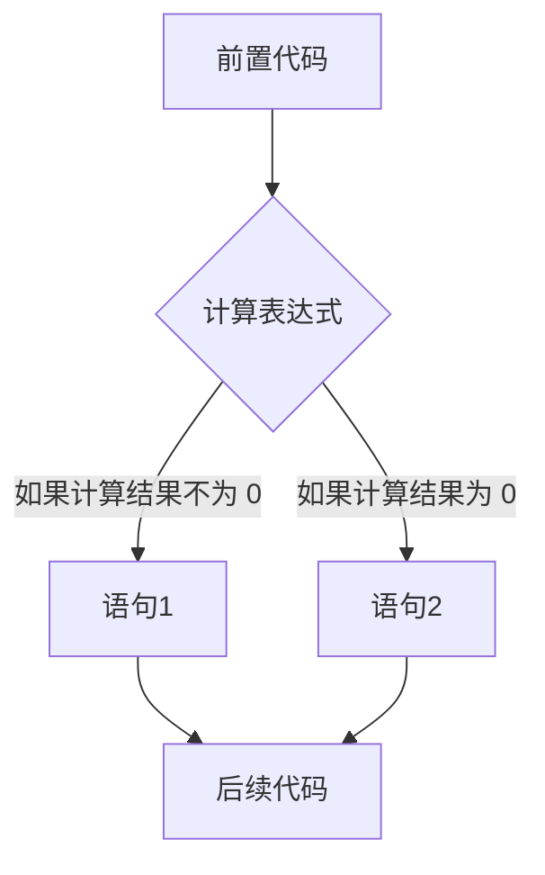
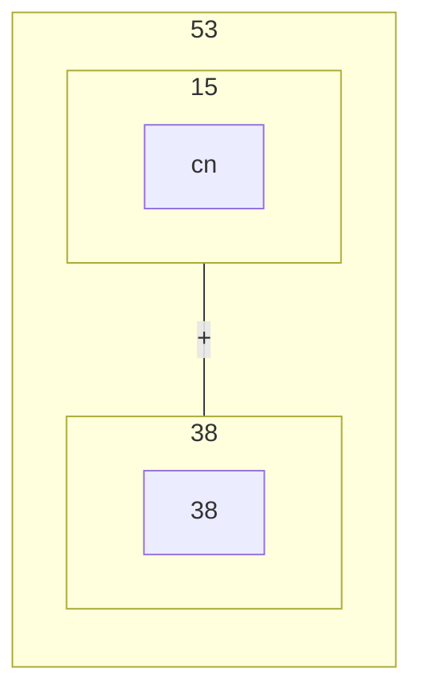
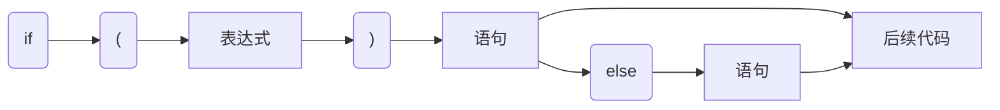

程序这种东西并不是每次都执行完全相同的操作的。比如说，如果按下一个按键就执行操作 A，按下另一个按键就执行操作 B……像这样，大多数程序都是基于某种判断的结果，选择性地执行操作。

本章将学习根据条件改变程序流程的基本步骤。

# 3-1 if 语句

## 程序的流程

大家每天都是怎么过的呢？随着第二天的到来，肯定不会一尘不变的对吧。当然，具体有没有那么在意每天的生活这些话先放一边，你肯定是进行某种判断决定自己的行动的。比如，

- 今天可能会下雪，所以我得给轮胎装上防滑锁链。

这类。

程序也是一样的。基本没有什么程序是只能执行完全确定的操作的。本章将学习基于条件改变程序流程的方法。那么首先，先思考以下问题。

```
如果输入的整数无法被 5 整除，就显示提示。
```

**List 3-1** 展示了实现的代码。

```c
/*
    判断输入的整数是否能被 5 整除
*/


#include <stdio.h>

int main(void)
{
    int vx;

    printf("请输入整数：");
    scanf("%d", &vx);

    if (vx % 5)
        puts("这个数无法被 5 整除。");

    return (0);
}
```
运行例（1）
```
请输入整数：17↵
这个数无法被 5 整除。
```
运行例（2）
```
请输入整数：15↵
```

## if 语句，其一

程序中出现了一个新的单词 `if`，它在英文的意思就是“如果”。像是
```c
if (表达式) 语句
```
这种写法被称为 **if 语句（if statement）**。

使用 if 语句就可以让程序做出下面的动作。
```
计算表达式的结果，如果不是 0 就执行后面的语句
```
也就是说，程序的流程会像 **Fig.3-1** 那样被控制。

> 为了判定条件而写在 `()` 内的**表达式**被称为**控制表达式（control expression）**。

Fig.3-1 if 语句的流程（其一）
```mermaid
flowchart LR
    flowchart TB
    A[前置代码] --> B{计算表达式}
    B --如果计算结果不为 0--> C[语句] --> D[后续代码]
    B --> D
```

这次的 if 语句的表达式，或者说控制表达式是 `vx % 5`。这个**表达式**的计算结果是 `vx` 除以 5 后的余数，所以当它的值为非 0，也就是 `vx` 无法被 5 整除时才会执行后面的
```c
puts("这个数无法被 5 整除。");
```
这条**语句**。

而且能从运行例中看出来，当输入的整数可以被 5 整除时，后面的**语句**不会被执行，也就**不会显示任何内容**。

## 判断奇数

如果将读取的整数除以 2 而不是 5，就可以判断这个数是不是奇数。**List 3-2** 展示了实现的程序。

List 3-2
```c
/*
    判断读取的整数是否为奇数
*/

#include <stdio.h>

int main(void)
{
    int no;

    printf("请输入整数：");
    scanf("%d", &no);

    if (no % 2)
        puts("这个数是奇数。");

    return (0);
}
```
运行例（1）
```
请输入整数：17↵
这个数是奇数。
```
运行例（2）
```
请输入整数：16↵
```

## if 语句，其二

运行 **List 3-1** 后，如果输入的数可以被 5 整除的话，程序不会输入任何内容。这样的话，使用程序的人可能会感到困惑，所以让我们就算能被 5 整除，也输出提示内容吧。**List 3-3** 展示了实现的程序。

List 3-3
```c
/*
    判断输入的整数是能被 5 整除还是不能
*/

#include <stdio.h>

int main(void)
{
    int vx;

    printf("请输入整数：");
    scanf("%d", &vx);

    if (vx % 5)
        puts("这个数无法被 5 整除。");
    else
        puts("这个数能被 5 整除。");

    return (0);
}
```
运行例（1）
```
请输入整数：17↵
这个数无法被 5 整除。
```
运行例（2）
```
请输入整数：35↵
整个数可以被 5 整除。
```

在这个程序里所使用的是
```c
if (表达式) 语句1 else 语句2
```

这样的 if 表达式。这样，括号里的**表达式**的计算结果如果为非 0 则会执行`语句1`，否则（如果为 0）则会执行`语句2`。所以，程序会像 **Fig.3-2** 这样选择性地执行。

从运行例里也能看出来，当输入的数能被 5 整除时，也会显示出提示。

Fig.3-2 if 语句的流程（其二）


## 奇数和偶数

**List 3-4** 展示了判断输入的整数是奇数还是偶数的程序。

List 3-4
```c
/*
    判断输入的整数是奇数还是偶数
*/

#include <stdio.h>

int main(void)
{
    int no;

    printf("请输入整数：");
    scanf("%d", &no);

    if (no % 2)
        puts("这个数是奇数。");
    else
        puts("整个数是偶数。");

    return (0);
}
```
运行例（1）
```
请输入整数：39↵
这个数是奇数。
```
运行例（2）
```
请输入整数：16↵
这个数是偶数。
```

## 表达式的计算结果

在 if 语句的解释里用到了“表达式的计算结果”这个表达。正如上一章说过的那样，变量或常量是表达式，将它们用运算符组合起来的东西也是表达式。

C 语言的表达式（除去一些例外）一定可以得到计算结果。比如我们来思考一下下面这个表达式吧（假设变量 `cn` 是 **int** 类型）。
```c
cn + 38
```
无论是`cn`、`38` 还是 `cn + 38`，它们都是表达式。

如果变量 `cn` 的值是 `15`，那么每个表达式的计算结果会像 **Fig.3-3** 这样分别为 `15`、`38` 和 `53`。

Fig.3-3 表达式的计算结果


## 判断非 0

**List 3-5** 展示了判断输入的数是否为 0 的程序。

`if` 表达式括号里的操作表达式只有一个 `num`。因为 `if` 表达式会根据操作表达式的值是否为 `0` 来决定程序的流程，所以判断变量 `num` 的值是 0 还是非 0 就可以像这样简单地编写。

List 3-5
```c
/*
    判断输入的整数是 0 还是非 0
*/

#include <stdio.h>

int main(void)
{
    int num;

    printf("请输入整数：");
    scanf("%d", &num);

    if (num)
        puts("这个数不是 0。");
    else
        puts("这个数是 0。");

    return (0);
}
```
运行例（1）
```
请输入整数：15↵
这个数不是 0。
```
运行例（2）
```
请输入整数：0↵
这个数是 0。
```

## 句型结构

**Fig.3-4** 展示了到目前为止的两种 if 表达式的句型结构（关于句型结构图的详细信息请看 **Column 3-1**）。

Fig.3-4 if 语句的句型结构图

